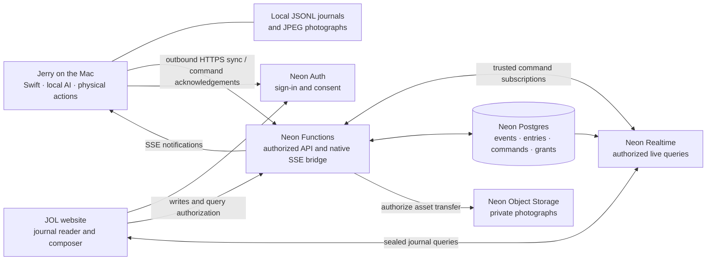

# Jerry On Line remote journals and missions

Research and proposed design · 8 November 2026

The initial prototype is now implemented and deployed to a dedicated development project. See [JOL setup and current validation](JOL_SETUP.md) for what works today; this document preserves the broader design and future phases.

**Jerry On Line (JOL) connects your desktop explorer to a server you choose.** Open its website to read his expedition journals as he writes, see his photographs and send the next direction. Jerry, his AI provider and all computer interaction continue to run on the Mac. JOL carries the journal and the instructions; Jerry still has to physically reach the controls.

The recommended backend is Neon Postgres, Functions, Auth and Realtime, with Neon Object Storage for journal photographs. Keep the macOS client in Swift. Use TypeScript on the server and for the web reader. Start with private, read-only journal sync, then add remote missions once the connection and recovery behavior are proven.

Product choices below describe the intended design, including features beyond the prototype. Compatibility questions have explicit investigation gates before implementation.

## 1. What the experience should be

### Connecting Jerry

1. In **Settings → Jerry On Line**, enter a server address, such as `https://jol.example.com`.
2. Jerry checks the server’s identity and protocol version, then shows its name and address before sign-in.
3. **Connect** opens that deployment’s Neon Auth sign-in and consent pages in the system browser. No Neon developer account is needed by an ordinary JOL user.
4. Name this Mac and choose what to share: new expedition notes, photographs and, separately, technical details. Existing journals stay local unless selected for upload.
5. Choose whether this Mac accepts remote missions. This starts off disabled and can be changed without disconnecting journal sync.

The settings page shows account, server, Mac name, connection state and any backlog. “Disconnect” stops future transfer and remote control; it does not silently erase either copy of the journal. Offer a separate, explicit server-data deletion action when deletion is implemented.

One server connection per Mac is enough for the first version. Design identifiers so an account can own several Macs later. Switching servers requires a fresh sign-in and sharing choice, never an automatic upload of the previous server’s history.

### Reading remotely

The JOL website opens to a list of expeditions and the selected journal. Jerry’s handwriting, typewritten directions, taped receipts and Polaroids should carry across from the native journal. Updates arrive without refreshing. Older expeditions can be read while the Mac is asleep or offline.

Show a small, truthful connection label: **Jerry is writing**, **Connected**, **Last seen 12 minutes ago**, or **Catching up**. Reading an archived journal must not imply the Mac is online. Initially show expedition state and journal activity, not a live desktop or a streamed character position.

### Sending directions

The composer continues the selected unfinished expedition. **New expedition** is a separate action. A finished expedition cannot receive a direction accidentally; offer to reopen it explicitly or start another.

When Jerry is busy, the default is **queue this direction**. An explicit **Steer now** action can interrupt at a safe action boundary, with the current expedition and run identified. A remote request must not silently cancel whatever the local user is doing. Local manual control pauses remote execution; queued work waits until remote operation is permitted again.

Distinguish **Saved on JOL → Received by this Mac → Started → Finished / Couldn’t finish**. “Delivered” is not the same as completing the requested computer action. Offline requests need a visible expiry, cancellation and a clear “waiting for this Mac” state. JOL cannot wake a sleeping Mac by itself.

## 2. Neon capabilities and constraints

| Component | Proposed responsibility | Important constraint |
| --- | --- | --- |
| Postgres | Journal events and read models, accounts’ access to devices/expeditions, durable commands, acknowledgements and audit records | The database is the durable coordination layer; timestamps alone are not ordering cursors. |
| Functions | Authenticated sync/command API, authorization, query sealing, native live-update bridge and asset authorization | Public HTTPS endpoints need application authentication. Processes can restart; memory is not durable state. |
| Neon Auth | User sign-in, browser sessions and native OAuth authorization | Each deployment needs login and consent UI, trusted domains and native client configuration. |
| Realtime | Live browser journals and notification that a Mac has pending commands | Read-only live SQL, currently beta; not a write API or a durable work queue. |
| Object Storage | Private JPEG journal photographs | Store file references in Postgres, not image blobs in every event. Authorize every upload/download. |

Neon Functions support long-lived SSE and WebSockets, with reconnection still required after eviction. Realtime publishes authoritative query results and transaction-consistent changes; clients must handle replacement snapshots. These make a good combination for this product, provided recovery reads the database rather than depending on observing every intermediate notification. [Functions runtime](https://neon.com/docs/compute/functions/reference/runtime-limits), [Realtime subscriptions](https://neon.com/docs/realtime/guides/subscribing).

Realtime is currently beta, has no performance guarantees, and does not yet implement RLS. Authorization must be built into the SQL being sealed, including joins to current access grants. The documented client and server integrations are JavaScript/TypeScript. [Realtime overview](https://neon.com/docs/realtime/overview), [query authorization](https://neon.com/docs/realtime/guides/queries#authorization).

Functions, Realtime and Object Storage currently overlap in AWS Ohio, N. Virginia, Frankfurt and Singapore. Verify product availability again when creating the deployment; Frankfurt is a sensible initial option for a UK-based operator. Managed Auth also has networking restrictions, so do not assume it can be combined with IP Allow or Private Networking. [Regional availability](https://neon.com/docs/introduction/regions#product-availability), [Auth overview](https://neon.com/docs/auth/overview).

Enabling Realtime enables project-wide logical replication and temporarily suspends existing computes/connections. Do this deliberately in a dedicated development project before experimenting with a shared production project. [Realtime prerequisites](https://neon.com/docs/realtime/overview).

## 3. Architecture

The browser uses Neon's official React/TypeScript Realtime bindings. The Mac uses `URLSession` for HTTPS and a small JOL SSE protocol. A Function subscribes using Neon's official server SDK and forwards notifications to Swift. This keeps beta wire-protocol changes on the server and avoids embedding JavaScriptCore just to establish a subscription. Validate the bridge under eviction and token expiry before committing to it.

All Mac connections are outbound. No port forwarding, public Mac listener or remotely exposed Accessibility service is needed. A short-lived loopback listener during sign-in is a separate OAuth callback mechanism, not a remote-control endpoint.

AI keys and ChatGPT credentials stay in the Mac’s Keychain. Connecting a JOL account does not sign in to an AI provider, and a JOL operator does not need an OpenAI API key. If the Mac’s AI connection needs attention, the remote mission waits and reports that condition.

### Where to host the website

Neon describes Functions and Storage as backend primitives rather than full-stack frontend hosting. Do not promise a conventional static website/CDN deployment simply because the backend runs on Neon.

The preferred **all-Neon prototype experiment** is a small web reader whose HTML is returned by a Function, with a prebuilt browser bundle included in its deployment archive. Functions accept prebuilt archives, which makes this plausible, but static asset routing, headers, bundle limits, caching, browser authentication and operational cost need testing. This is an application design to validate, not an advertised Neon frontend-hosting feature. [Function deployment](https://neon.com/docs/compute/functions/deploy), [Function configuration](https://neon.com/docs/reference/neon-ts).

If that becomes awkward, use a static React frontend on the operator’s existing host, with the entire backend still on Neon. A small `public_read` Storage page is another prototype option, but buckets lack website fallback routing and custom domains; it is not the preferred polished web deployment. Use a single JOL address for users regardless of deployment packaging. [Object Storage](https://neon.com/docs/storage/overview).

Functions support custom domains with managed TLS. Keep a configured canonical JOL origin: the internal Function `Host`/request URL can be the native Neon hostname even when the visitor used a custom domain. [Custom domains](https://neon.com/docs/compute/functions/custom-domains).

## 4. Deployment identity and sign-in

### Server discovery

Define a small JOL-owned discovery document at `/.well-known/jerry-online`. This is a proposed Jerry protocol, not an existing Neon standard. It advertises:

- Stable server instance UUID, display name, canonical HTTPS origin and protocol versions.
- API and native stream endpoints, constrained to the expected origin in version 1.
- Exact Neon Auth issuer, OAuth client ID and API resource/audience.
- Capabilities: read-only sync, photos, remote commands, maximum batch size and compatible client versions.

Validate HTTPS, redirects and URL components before opening authentication. Permit plain HTTP only in an explicit development configuration. Never follow discovery instructions that send existing credentials to another origin. Show the chosen host in sign-in and sharing UI. Do not fetch arbitrary URLs supplied in remote commands.

Scope account identity to **server instance + exact issuer + subject ID**, not email address. Namespace Keychain records and sync cursors by instance and device. A changed issuer or instance ID at the same URL requires reconnection, not silent reuse of credentials.

### Native OAuth with Neon Auth

Use Neon Auth’s managed OAuth Provider with authorization code + S256 PKCE, a public native client and `state`. Configure JOL’s API URL as the protected resource and request `offline_access` for background reconnects. There is no client secret to embed in Jerry. The deployment must host both login and consent pages and register their trusted origins. [OAuth Provider](https://neon.com/docs/auth/guides/plugins/oauth-provider).

There is a concrete native callback constraint: managed clients currently accept HTTPS or explicitly allowed loopback HTTP redirects, **not custom schemes such as `jerry://`**. Managed redirects must match exactly; dynamic loopback-port matching is documented for CIMD clients, whose self-onboarding is restricted to MCP resources. Do not turn JOL into an MCP server just to bypass client registration. [Redirect rules](https://neon.com/docs/auth/guides/plugins/oauth-provider#redirect-uri-rules).

The initial spike should test a registered loopback callback on a chosen port, with loopback access enabled and the listener opened before the system browser. Test an occupied port and cancellation. Verify the appropriate browser/authentication-session API on the supported macOS versions; a normal system-browser flow plus a tightly scoped loopback listener is a fallback if an authentication session requires a custom scheme. An operator-controlled HTTPS callback plus one-time device handoff is another design if fixed ports prove unacceptable, but adds server state and must be designed explicitly.

Serialize refreshes in a Swift actor and atomically replace the rotating refresh token in Keychain. Do not assume concurrent refresh retries are safe: the documented reuse grace depends on OAuth provider configuration. Handle expiry/revocation with “Reconnect”, preserving local journals and pending sync. Neon OAuth resource access tokens and web session JWTs are different flows with different lifetimes; validate each against its documented issuer/audience rather than borrowing a session-token example. [Token and refresh behavior](https://neon.com/docs/auth/guides/plugins/oauth-provider#token-details).

The API verifies signature, exact issuer, audience membership, expiry and required authorization. Branches can share signing keys and inherited OAuth client IDs: signature verification alone cannot isolate production from a preview branch. Reject tokens from every other issuer even when their signature verifies. Do not use an ID token as an API access token.

Connecting to a server makes its operator a custodian of the shared notes/photos. Enabling remote missions also makes that deployment part of the Mac’s control trust boundary. HTTPS protects transport; this design is not end-to-end encrypted against the operator. State this plainly in the sharing choices, without implying that keeping AI keys local prevents a compromised server from issuing directions. Strong protection against a malicious operator would require a separate design for end-user encryption and signed commands.

### Users, permissions and device binding

Start owner-only, with app-owned workspace/membership tables. Do not make the initial implementation depend on the Auth Organizations beta. Model **owner**, **reader** and **controller** permissions now so read-only sharing can follow without retrofitting every query.

After authenticated enrollment, bind a device installation to its owner and a device possession credential, stored in Keychain and revocable on JOL. Use it alongside user authentication for device-only upload/claim/ack routes; a browser session must not impersonate the Mac merely by knowing its UUID. Decide between a hashed, scoped device token and a signing key in the authentication spike. This is JOL device enrollment, not an assumed Neon machine-to-machine OAuth grant.

API tokens do not encode permanent permission. Check current workspace/device/expedition grants on writes, claims and stream authorization. Access revocation must stop new commands and live visibility without waiting for a long-lived browser session to expire. Sealed live queries are bearer capabilities; keep them short-lived, out of URLs/logs and scoped by current grant joins. [Sealing queries](https://neon.com/docs/realtime/guides/queries#sealing-queries).

## 5. Postgres data model

Use relational ownership and cursors around a versioned JSON event payload. Suggested tables:

| Table | Main purpose |
| --- | --- |
| `jol_instances` | Instance identity and protocol/schema metadata. |
| `workspaces`, `memberships` | Auth subject ownership and reader/controller grants. Initially one private workspace per owner. |
| `devices` | Installation UUID, owner, display name, revocation, capabilities and last server-received heartbeat. |
| `expeditions` | Stable local UUID scoped to its device/workspace, title, state, active run and latest synchronized revision. |
| `journal_events` | Immutable transport events, event UUID, ordered stream sequence, schema version and sanitized payload. |
| `journal_entries` | Materialized readable notes/prompts/details/photo references, with stable entry IDs and revisions. |
| `sync_streams` | Stream generation, last contiguous accepted sequence and sharing-policy revision. |
| `assets` | Private object key, expedition/entry ownership, digest, size, MIME type and transfer/deletion state. |
| `commands` | Durable remote instructions, author, target, expected expedition/run, expiry, lifecycle and result. |
| `command_attempts` | Claims, lease/fencing generation, execution acknowledgement and uncertainty after interruption. |
| `access_audit` | Connection, enrollment, permission and remote-command changes without credentials or redundant screen data. |

Use composite uniqueness/foreign keys so one workspace/device cannot reference another’s expedition or photo. Authenticate owner scope on the server; never accept a client-provided owner ID as authority. Store server receipt time alongside client display time. Use sequences/revisions for synchronization, not wall-clock sorting or UUID ordering.

The Mac is the sole author of an expedition’s journal stream. The website submits commands; it does not edit Jerry’s journal records directly. A direction appears as a pending delivery in the website, then becomes a normal journal prompt when Jerry actually accepts it. Correlate these using the command UUID to avoid duplicate prompt cards.

## 6. Local-first journal synchronization

### Integrate with the existing store

Jerry already saves versioned append-only JSONL and local JPEGs under `Application Support/Jerry/Expeditions/<UUID>/`. Events have stable IDs, and streaming text uses deltas. This is a strong base for sync. See [Journal storage](JOURNAL_STORAGE.md).

However, records currently have no monotonic transport sequence, and UI mutations can be emitted before disk writes succeed. A network subscriber to UI updates would risk publishing text that was never saved locally. Add a durable-store acknowledgement or a committed-file scanner, then maintain a separate persistent sync outbox/cursor. Keep local journal saving independent of network health.

Proposed flow:

1. Save the local event successfully, preserving the existing writer and recovery behavior.
2. Derive a sanitized sync event under the current sharing policy. Allocate a contiguous transport sequence and persist it before attempting delivery.
3. Upload small ordered batches with stream ID/generation, sequence, event UUID and payload digest.
4. In one Postgres transaction, authorize the stream, deduplicate events, apply the contiguous batch to entries/state and advance its acknowledgement.
5. Persist the acknowledged cursor locally. Re-sending a batch after a lost response is harmless.

Reject conflicting reuse of an ID/sequence with different content. Reject gaps with the expected next sequence rather than applying later text deltas out of order. Replayed duplicate events must not append the same text twice. Use a bounded batch target, initially around 250–1,000 ms while streaming, with immediate flush at meaningful boundaries; tune against actual latency and write volume. Nothing belongs in the movement/rendering loop.

Privacy filtering means transport sequence cannot simply be every local line number: excluded details/photos must not create unexplained gaps. Keep a stable mapping between committed local records and sanitized transport records; a policy change uses an explicit projection revision/backfill operation. Older history can start with a versioned snapshot at a documented base cursor, followed by deltas. Never fabricate a missing `created` event or silently rewrite a stream under existing sequence IDs.

Reconnect with exponential backoff and jitter, and reconcile against the server’s accepted cursor. Cap memory, batch size and pending upload work; journals remain usable offline. On restart, rebuild pending work from durable state. A local save failure is distinct from a network backlog.

### Photos and technical details

Default sharing should be human-readable journal notes and directions. Raw technical receipts may include visible screen text and request metadata, so make their upload a separate opt-in. Filter before the network boundary, including fields nested in an `entry` record.

Photographs need their own explicit sharing choice, independent of terrain capture and AI image sharing. With permission, upload the existing local JPEG to a private Neon Storage bucket through short-lived authorized upload URLs or a streaming API route. Validate ownership, digest, type and size before marking it available. Never expose bucket credentials to the browser or Mac. [Storage objects](https://neon.com/docs/storage/objects), [storage authentication](https://neon.com/docs/storage/authentication).

Upload notes first and show a paper placeholder while a photograph catches up. Keep the caption if the image is unavailable. Authorize image reads against the same expedition grants; use short-lived downloads or an authenticated image route and private cache policy. Presigned URLs remain usable until expiry, so do not claim instant revocation of already-issued URLs or downloaded copies.

Add deletion tombstones before offering cloud deletion. Otherwise an offline outbox could recreate deleted content on reconnect. Specify separately: stop sharing an expedition, delete its server copy, delete its local copy and delete an account. Backups have their own retention window.

## 7. Realtime delivery

### Browser journal

The Functions API authenticates the viewer and seals predefined queries. Browser clients cannot supply arbitrary SQL, device ownership or unrestricted filters. Queries join current memberships/device/expedition grants, and expired/revoked sessions must stop receiving renewals. Avoid placing secrets or developer SQL errors in browser results.

Subscribe to expedition summaries, device presence and the currently visible range of journal entries. Load historical pages through the API and live-subscribe to a bounded, stable recent range; do not subscribe to every event in every expedition. A rolling `LIMIT` query can remove old rows simply because newer rows enter the result, so keep that separate from actual deletion in the UI. Always key entries by application IDs, not Realtime’s subscription-scoped row IDs.

Provide a renewal callback for sealed queries and handle replacement snapshots after reconnect. If Realtime fails, show a delayed-update state and fall back to periodic authenticated reads. Writes still use the API. Optional transaction-ID acknowledgement can reconcile optimistic command cards with live rows. [Query definition](https://neon.com/docs/realtime/guides/queries), [subscriptions](https://neon.com/docs/realtime/guides/subscribing).

### Swift notification bridge

An authenticated SSE route subscribes server-side to that device’s actionable command rows using the official Realtime SDK. Forward small messages such as `commands_changed` and `access_changed`; the Mac then fetches/claims authoritative commands. No provider-specific Realtime messages leak into the native protocol.

Send immediate connection state and regular heartbeats, close on revoked authorization or token expiry, and reconnect with fresh authorization. On every connection, app launch, wake and network restoration, reconcile outstanding commands even if no notification arrives. While connected, a low-frequency reconciliation read is additional protection against a lost hint. Dispose subscriptions when streams close and recreate SDK clients after terminal errors.

Do not use module-scope memory to decide which Mac owns a command. Function isolates may scale independently or disappear. Keep leases, results and cursors in Postgres. [Trusted backend subscriptions](https://neon.com/docs/realtime/guides/subscribing#subscribe-in-trusted-backend-code), [runtime lifecycle](https://neon.com/docs/compute/functions/reference/runtime-limits).

## 8. Executing remote missions reliably

Proposed command types are `start_expedition`, `continue_expedition`, `steer_expedition`, `finish_expedition`, `stop` and `cancel_queued`. Each has an idempotency key, target device, expedition where relevant, expected state/run where relevant, author and expiry. The server derives permission from authentication, not command payload claims.

The Mac claims commands transactionally with a lease and increasing fencing generation. A stale connection cannot acknowledge or resume a command after another claim supersedes it. Renew leases while running; command acknowledgement and journal correlation use stable command IDs. Order routine prompts per device; stop/cancel can bypass the routine queue but still require authorization and a matching target.

On the Mac, put a coordinator in front of `AgentTaskController`. Its current `submit` path stops the previous task; invoking it blindly for each remote prompt would interrupt work. The coordinator must validate state, wait for the previous task to drain, honor local manual takeover and serialize execution. Preserve existing `runID` fencing and stopped-task cancellation.

“Started exactly once” and “clicked exactly once” are different promises. A process can crash after a physical click but before its acknowledgement. Persist command acceptance/start locally, but do not automatically replay an ambiguous in-progress computer action. Mark it **Needs a fresh direction**, capture fresh permitted context and ask for continuation. An interrupted run restores paused, consistent with existing journal recovery.

After a Mac restart, previously running commands stay paused. Newly queued offline commands should also wait for explicit local re-arming in the first version, rather than surprising the user at login. Online, an armed Mac can accept newly submitted remote directions automatically. Make that policy visible alongside “Allow remote missions”.

Remote access does not bypass macOS permissions, AI-sharing settings or future task-specific confirmations. If Accessibility, Screen Recording or the AI account needs local attention, report the actual blocker and leave the instruction available. Remote “Stop” is best effort when the network is unavailable; local interruption remains immediate.

## 9. Proposed HTTP contract

These routes are a planning sketch, not implemented API:

| Route | Caller and purpose |
| --- | --- |
| `GET /.well-known/jerry-online` | Public server discovery, without account or device data. |
| `POST /v1/devices` | Authenticated owner enrolls a Mac; returns its scoped enrollment material. |
| `POST /v1/devices/:id/heartbeat` | Bound Mac reports availability and capability state. |
| `POST /v1/streams/:id/batches` | Bound Mac uploads committed sanitized events; response includes accepted cursor. |
| `GET /v1/expeditions` / `GET /v1/expeditions/:id/entries` | Authorized summaries and paginated recovery reads. |
| `POST /v1/live-queries` | Seal one named, authorized browser query with validated range parameters. |
| `GET /v1/devices/:id/events` | Bound Mac’s authenticated SSE notification stream. |
| `POST /v1/commands` | Controller submits a validated direction; returns durable queued command. |
| `POST /v1/devices/:id/commands/claim` | Bound Mac claims eligible work under a lease/fence. |
| `POST /v1/commands/:id/ack` | Bound Mac records received/started/terminal result using the current fence. |
| `POST /v1/assets/uploads` / `GET /v1/assets/:id` | Authorized asset transfer, with private delivery. |

Use versioned DTOs, bounded text/body sizes, stable structured errors, pagination and rate limits. Authenticate native SSE using request headers, not a token in the query string. For a separate-origin Vite frontend, use the supported Auth token flow and an explicit CORS allowlist; do not assume the Neon Auth cookie reaches the Functions origin. A same-origin auth proxy is an alternative to validate, not a reason to invent cookie forwarding. [Functions authentication](https://neon.com/docs/compute/functions/authentication), [Realtime auth example](https://neon.com/docs/realtime/guides/queries#exposing-an-endpoint).

## 10. Hosting and operating your own JOL

“Self-hostable” means an operator deploys the open-source JOL application into their own Neon project and controls its URL, accounts and retention. It does not mean packaging managed Neon itself onto a home server. There is no required Jerry-operated registry, proxy or shared login service.

Keep the server/web code in a distinct directory in this repository, with migrations, protocol fixtures and a declarative `neon.ts`. A future deployment guide should cover:

1. Create/choose a claimed Neon project in a compatible region, and create a development branch.
2. Provision Postgres, Auth, Functions, Realtime and the private photo bucket through version-controlled configuration. Review any project-wide replication impact first.
3. Apply schema migrations and create least-privilege runtime access; keep DB, sealing and storage credentials server-side.
4. Deploy web login/consent and API, configure canonical origin, Auth trusted domains and the public native OAuth client/resource.
5. Bootstrap the first owner through an operator-controlled process. Public sign-up must never grant instance administration. Start invite-only for personal servers.
6. Configure production email delivery and any social provider credentials. Auth is hosted by Neon, but production email/social configuration still needs operator setup. [Auth production checklist](https://neon.com/docs/auth/production-checklist).
7. Configure a custom domain/TLS if desired, test discovery and sign-in, and enroll a disposable development Mac profile.
8. Verify backups, retention, error reporting, revocation and upgrade/rollback before enabling remote commands.

Preview branches need distinct issuer/audience/canonical-origin checks and isolated device registrations. Disable remote execution by default on previews. Prefer schema-only or synthetic-data development branches for journals; copy-on-write data/assets and Auth state can otherwise expose real screen content to a development environment. Ensure copied instance settings cannot cause a Mac to switch environments accidentally.

Maintain migrations separately from live requests; never race schema setup across Function isolates. Keep deployment secrets out of Git and browser bundles. Document a version compatibility window so updating a server does not strand installed Macs, and report incompatible versions before uploading data or claiming commands.

Long-lived native streams and Realtime queries can keep backend resources active. Measure database compute, Function concurrency, subscriptions, network transfer, write amplification and photo storage before suggesting an operating budget. Realtime’s current beta pricing is not a permanent cost assumption. Plan retries for throttling and bound per-device/viewer subscriptions. [Realtime costs](https://neon.com/docs/realtime/overview), [Function limits](https://neon.com/docs/compute/functions/reference/runtime-limits).

## 11. JOL identity and visual design

Use **Jerry On Line**, shortened to **JOL**, with an original wordmark and Jerry’s existing hat/head geometry. The AOL reference should come through in the idea of going online, friendly connection language and a little late-1990s optimism, without copying its logo or making the interface difficult to use.

The outer JOL shell can have a restrained blue accent, connection lamp and small “Connecting…” sequence. Once inside an expedition, the warm notebook takes over: Caveat for Jerry’s writing, typewriter scraps for your directions/technical receipts, taped Polaroids for achievements. Provide a mobile-friendly single-column journal and a collapsible expedition list. Keep controls conventionally legible even when the journal is playful.

Possible moments: “Jerry is on line”, “You’ve got field notes”, or a small envelope arriving when a new note appears. Sound is off by default, motion respects reduced-motion preferences, and none of this delays sign-in or hides delivery state. Avoid a modal dial-up animation every reconnect. The macOS menu only needs a concise connection/status entry; configuration belongs in Settings, preserving the two-level menu limit.

## 12. Delivery phases and acceptance gates

### Phase 0 — prove the uncertain integrations

Use disposable accounts/data and a development branch when implementation is authorized. Validate:

- **Native Auth:** registered public-client PKCE, exact loopback redirect, occupied port/cancel paths, rotating refresh across sleep and restart, cross-issuer rejection and logout/revocation behavior.
- **Web delivery:** one URL for discovery/login/consent/API and a small journal reader on Functions, correct asset/content/cache headers and deploy size. Choose the static-host fallback if this is brittle; record the additional hosting requirement plainly.
- **Realtime bridge:** trusted SDK subscription inside a Function, native SSE reconnect/expiry/eviction, snapshot replacement and command catch-up. No raw Neon protocol in Swift.
- **Authorization:** another account cannot read notes, seal a broader query, fetch an image, upload as a Mac or claim its commands; revoke access during a live subscription and active lease.

Exit with a tested deployment recipe and concrete protocol/auth decisions. Do not start the full UI until these pass.

### Phase 1 — private read-only sync

Add JOL settings/sign-in, device enrollment, committed-event outbox, batch ingest/read model and web journal history. Start notes-only, one owner and one Mac. Include manual selection for historical upload, status/retry/disconnect and isolated test directories.

Acceptance: an offline journal remains intact; restarting either side and replaying batches produces identical readable text without duplicates or gaps. No credentials, photos or technical receipts leave by default.

### Phase 2 — live journal and photographs

Add sealed live queries, snapshot/reconnect handling, presence and optional private photo transfer. Recreate the native journal’s handwriting, scraps and Polaroids on desktop and mobile browsers.

Acceptance: text/photo updates appear promptly under normal connectivity, historical scrolling stays stable, revoked viewers lose ongoing access, and fallback reads recover from a Realtime outage. Measure actual latency rather than promising a beta SLA.

### Phase 3 — remote directions

Add durable commands, native coordinator, leases/fences, start/continue/steer/stop, explicit arming and honest delivery states. Preserve local takeover and paused recovery.

Acceptance: remote directions result in Jerry’s normal physical actions on a disposable app fixture; busy/offline/restarted Macs handle work predictably. Duplicate requests and ambiguous execution never blindly repeat physical actions.

### Phase 4 — operator release and sharing

Package deployment/upgrade/backup instructions, quotas, data deletion/tombstones, device revocation and owner-controlled reader/controller invites. Add multiple-device selection only once targeting is explicit throughout the UI and API.

Acceptance: a second person can deploy an independent JOL instance from the guide, enroll their Mac and read/send a mission without help or a Jerry-operated service. Two instances cannot exchange identities, data or commands accidentally.

## 13. Verification matrix

| Area | Cases that must be exercised |
| --- | --- |
| Sync | Duplicate/reordered/missing batches; lost acknowledgement; text replacement; malformed JSONL tail; local disk failure; historical import; policy change; unsupported schema. |
| Connectivity | Mac asleep, app quit/relaunch, server eviction, Wi-Fi loss, long offline backlog, clock skew, rate limiting and Realtime unavailable. |
| Auth/access | Token expiry and concurrent refresh; wrong issuer/audience; copied preview clients; account switch; changed server identity; revoked device/member; stolen/expired query capability. |
| Commands | Duplicate browser submission; two tabs; local prompt racing remote prompt; manual takeover; wrong/stale expedition/run; expired queue item; lease loss; crash before/after a click and before acknowledgement. |
| Privacy/assets | Photo/details opt-out; no retroactive upload; nested-field filtering; unauthorized object URL; partial upload; corrupt/missing image; cloud deletion while Mac offline; no credentials in logs. |
| UI | Keyboard access, narrow/mobile width, long whimsical titles, streaming text while scrolled up, stable auto-follow near bottom, reduced motion, clear offline and queued states. |

Use synthetic journal fixtures and temporary local stores, never the real journal history. End-to-end remote-action tests should operate disposable native fixtures and verify actual effects, not only command acknowledgement. Visual review must cover the web notebook as well as macOS Settings.

## 14. Decisions to retain and questions to revisit

Recommended initial scope: one private JOL account/workspace, one chosen server per Mac, human-readable notes first, photos opt-in, remote control off until explicitly armed, AI execution and credentials local, and owner-only remote commands before invitations.

Resolve in Phase 0: exact callback/browser implementation, the device-binding credential, all-Neon web delivery versus static hosting, live-query revocation/session integration, SDK versions and supported deployment regions. Resolve before remote control ships: queue/steer UX and expiry defaults, which tasks still require local confirmation, retention/deletion semantics and operator quotas.

Defer public journals, anonymous share links, federated servers, live desktop video, cloud AI execution, remote wake, cross-device expedition handoff and collaborative journal editing. None is needed to deliver the central experience: **open your chosen JOL address, read Jerry’s latest field notes and send him his next expedition.**
